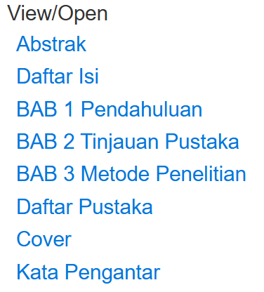
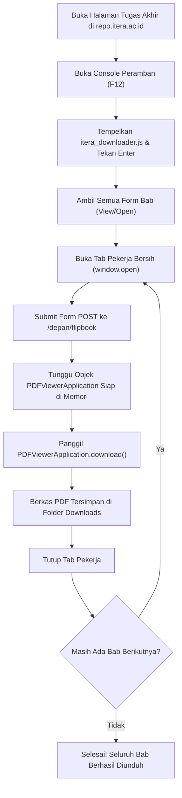

# ITERA Repository Batch PDF Downloader
**Created By Febvn**

Skrip otomasi peramban (*browser*) untuk mengunduh seluruh dokumen bab tugas akhir, skripsi, dan karya ilmiah dari repositori resmi Institut Teknologi Sumatera (ITERA) secara berurutan dan otomatis ke format PDF.

- **Website Repositori ITERA:** [https://repo.itera.ac.id](https://repo.itera.ac.id)
- **Contoh Dokumen (Teknik Informatika):** [https://repo.itera.ac.id/depan/submission/SB2607300011](https://repo.itera.ac.id/depan/submission/SB2607300011)
- **Repositori GitHub:** [https://github.com/Febvn/Research-Repository-ITERA-Downloader-](https://github.com/Febvn/Research-Repository-ITERA-Downloader-)

---

## Salin Kode Skrip Langsung (Full JavaScript)

Salin seluruh blok kode di bawah ini untuk langsung ditempelkan ke konsol peramban (*DevTools Console*):

```javascript
/**
 * ITERA Repository Batch Flipbook to PDF Downloader
 * Created By Febvn
 * 
 * Skrip otomasi peramban untuk mengunduh seluruh berkas PDF bab tugas akhir/skripsi
 * dari repositori institusi ITERA secara berurutan.
 */

(async () => {
    console.log("----------------------------------------------------------");
    console.log("ITERA Batch PDF Downloader - Created By Febvn");
    console.log("----------------------------------------------------------");

    const forms = Array.from(document.querySelectorAll('form[action*="flipbook"]'));
    if (!forms.length) {
        return alert("Error: Form dokumen bab tidak ditemukan. Pastikan Anda berada di halaman repositori ITERA yang menampilkan daftar berkas.");
    }

    console.log(`[INFO] Terdeteksi ${forms.length} berkas bab. Memulai proses unduhan...`);

    for (let i = 0; i < forms.length; i++) {
        const form = forms[i];
        const title = form.querySelector('input[type="submit"]')?.value || `Dokumen_${i + 1}`;
        const fileName = form.querySelector('input[name="nama_file"]')?.value || '';

        console.log(`\n[${i + 1}/${forms.length}] Memuat: ${title} (${fileName})...`);

        const winName = `itera_worker_${i}`;
        const worker = window.open('about:blank', winName);
        if (!worker) {
            alert("Pop-up diblokir peramban. Harap izinkan pop-up (Always Allow) di bilah alamat, lalu jalankan kembali skrip.");
            return;
        }

        form.target = winName;
        form.submit();

        let downloaded = false;
        const maxAttempts = 35; // 35 x 800ms = 28 detik maksimal tunggu per bab

        for (let wait = 0; wait < maxAttempts; wait++) {
            await new Promise(resolve => setTimeout(resolve, 800));
            try {
                const app = worker.PDFViewerApplication;
                if (app && app.pdfDocument && typeof app.download === 'function') {
                    console.log(`[INFO] Berkas ${title} berhasil dimuat ke memori. Mengunduh...`);
                    app.download();
                    console.log(`[SUKSES] ${title} berhasil diunduh.`);
                    downloaded = true;
                    break;
                }
            } catch (err) {
                // Menunggu halaman transisi dan selesai memuat dokumen
            }
        }

        if (!downloaded) {
            console.warn(`[TIMEOUT] Gagal memuat berkas untuk ${title}. Melanjutkan ke bab berikutnya.`);
        }

        // Jeda waktu agar unduhan selesai didaftarkan oleh peramban sebelum tab ditutup
        await new Promise(resolve => setTimeout(resolve, 2000));
        try {
            worker.close();
        } catch (e) {
            // Tab sudah tertutup
        }

        // Jeda stabilitas jaringan sebelum memproses bab berikutnya
        console.log("[INFO] Menunggu 2 detik sebelum memproses bab berikutnya...");
        await new Promise(resolve => setTimeout(resolve, 2000));
    }

    console.log("\n----------------------------------------------------------");
    console.log("Proses Selesai: Seluruh berkas bab telah diunduh.");
    console.log("Created By Febvn");
    console.log("----------------------------------------------------------");
    alert("Selesai! Seluruh berkas bab telah otomatis diunduh ke folder Downloads Anda.");
})();
```

---

## 1. Kegunaan

Pada repositori institusi ITERA (`repo.itera.ac.id`), dokumen tugas akhir umumnya dipecah menjadi beberapa bab terpisah (Cover, Kata Pengantar, Abstrak, Daftar Isi, BAB 1 sampai BAB 5, dan Daftar Pustaka). Pengunjung situs biasanya diwajibkan membuka setiap bab satu per satu melalui penampil lembar animasi (*flipbook*). Selain itu, tombol unduh resmi sengaja disembunyikan di dalam antarmuka penampil dokumen.

Skrip ini dibuat untuk mengatasi kendala tersebut dengan kegunaan:
- Mengotomatisasi pembukaan dan pengunduhan seluruh bab dokumen sekaligus tanpa intervensi manual satu per satu.
- Menyimpan setiap bab sebagai berkas PDF asli berkualitas tinggi langsung ke direktori penyimpanan lokal (folder Downloads).
- Berjalan langsung di peramban pengguna, sehingga tidak terhalang oleh mekanisme proteksi bot (Cloudflare Turnstile) yang diterapkan pada server kampus.

---

## 2. Panduan Penggunaan & Tutorial Visual

Ikuti langkah-langkah berikut untuk menjalankan skrip:

### Langkah 1: Buka Halaman Repositori Dokumen
Buka peramban (Google Chrome, Microsoft Edge, atau Mozilla Firefox), lalu kunjungi halaman repositori tugas akhir yang ingin diunduh. Pastikan bagian **View/Open** yang memuat tautan seluruh bab dokumen telah terlihat di layar Anda.



> **Catatan:** Selesaikan verifikasi keamanan Cloudflare Turnstile jika muncul di layar hingga halaman daftar bab terbuka secara normal.

### Langkah 2: Buka Konsol Peramban (DevTools Console)
Pada halaman repositori tersebut:
1. Tekan tombol keyboard `F12` (atau kombinasi tombol `Ctrl + Shift + I`).
2. Klik tab **Console** pada panel pengembang yang muncul.

### Langkah 3: Eksekusi Skrip
1. Salin seluruh kode pada bagian [Salin Kode Skrip Langsung](#salin-kode-skrip-langsung-full-javascript) di atas atau dari berkas [itera_downloader.js](itera_downloader.js).
2. Tempelkan (*paste*) kode tersebut ke tab **Console**, lalu tekan **Enter**.
3. Jika peramban menampilkan dialog perizinan pop-up atau unduhan berganda (*"Allow multiple files to download"*), pilih opsi **Allow / Izinkan**.

### Langkah 4: Selesai
Peramban akan secara otomatis membuka jendela tab pekerja sementara, memuat dokumen, mengunduh file PDF asli ke folder Downloads, menutup tab tersebut, dan melanjutkan ke bab berikutnya sampai seluruh dokumen selesai diunduh.

---

## 3. Alur Kerja (Workflow)



---

## 4. Cara Kerja Teknis

1. **Bypass Pembatasan Otomasi dan CSRF**  
   Pengunduhan langsung menggunakan library eksternal (seperti `fetch` atau `curl`) umumnya terblokir oleh mekanisme verifikasi bot Cloudflare dan token CSRF. Skrip ini dijalankan langsung di dalam sesi peramban pengguna yang telah tervalidasi, memanfaatkan elemen `<form>` bawaan halaman dengan metode HTTP POST resmi ke *endpoint* `/depan/flipbook`.

2. **Isolasi Lingkungan Antar-Bab (Clean Worker Tab)**  
   Setiap bab dimuat pada jendela pekerja independen (`window.open('about:blank', winName)`). Penggunaan jendela terpisah per bab mencegah konflik memori (*state leakage*) dari penampil PDF sebelumnya, memastikan setiap berkas PDF yang dimuat dan diunduh adalah berkas yang sesuai dengan target bab.

3. **Interaksi Langsung dengan Mozilla PDF.js API**  
   Repositori ITERA menggunakan pustaka penampil dokumen Mozilla PDF.js. Meskipun tombol unduh disembunyikan menggunakan aturan CSS `style="display: none;"`, objek global `PDFViewerApplication` tetap aktif di dalam memori jendela peramban. Skrip memantau status kesiapan objek `PDFViewerApplication.pdfDocument`, lalu secara langsung memanggil metode `PDFViewerApplication.download()` untuk memulai pengunduhan berkas biner asli.

4. **Pengaturan Antrean dan Jeda Jaringan**  
   Skrip dilengkapi mekanisme jeda waktu (*delay*) adaptif agar peramban memiliki waktu yang cukup untuk mendaftarkan proses unduhan ke manajer unduhan lokal sebelum tab pekerja ditutup, sekaligus mencegah kelebihan beban permintaan (*rate limiting*) ke server repositori.

---

## 5. Penjelasan Kode (Kode per Bagian)

Berikut adalah bedah teknis dari berkas [itera_downloader.js](itera_downloader.js):

```javascript
const forms = Array.from(document.querySelectorAll('form[action*="flipbook"]'));
if (!forms.length) {
    return alert("Error: Form dokumen bab tidak ditemukan...");
}
```
> Mengumpulkan semua elemen formulir di halaman yang mengarah ke *endpoint* flipbook ITERA. Setiap formulir mewakili satu bab dokumen tugas akhir.

```javascript
const winName = `itera_worker_${i}`;
const worker = window.open('about:blank', winName);
form.target = winName;
form.submit();
```
> Membuat jendela/tab peramban baru dengan target nama unik untuk setiap iterasi bab, kemudian mengarahkan pengiriman data formulir POST ke jendela tersebut.

```javascript
let downloaded = false;
const maxAttempts = 35; // 35 x 800ms = 28 detik maksimal tunggu per bab

for (let wait = 0; wait < maxAttempts; wait++) {
    await new Promise(resolve => setTimeout(resolve, 800));
    try {
        const app = worker.PDFViewerApplication;
        if (app && app.pdfDocument && typeof app.download === 'function') {
            app.download();
            downloaded = true;
            break;
        }
    } catch (err) {}
}
```
> Melakukan pengecekan berulang (polling) setiap 800 milidetik ke jendela pekerja. Begitu objek `PDFViewerApplication` dan dokumen PDF selesai didekode ke dalam memori, skrip memicu pemanggilan fungsi `app.download()` dan segera keluar dari perulangan tunggu.

```javascript
await new Promise(resolve => setTimeout(resolve, 2000));
try {
    worker.close();
} catch (e) {}
await new Promise(resolve => setTimeout(resolve, 2000));
```
> Memberikan waktu jeda 2 detik agar berkas berhasil masuk ke antrean unduhan peramban, menutup jendela pekerja untuk membebaskan alokasi memori, lalu memberi jeda tambahan 2 detik sebelum memproses bab berikutnya.
